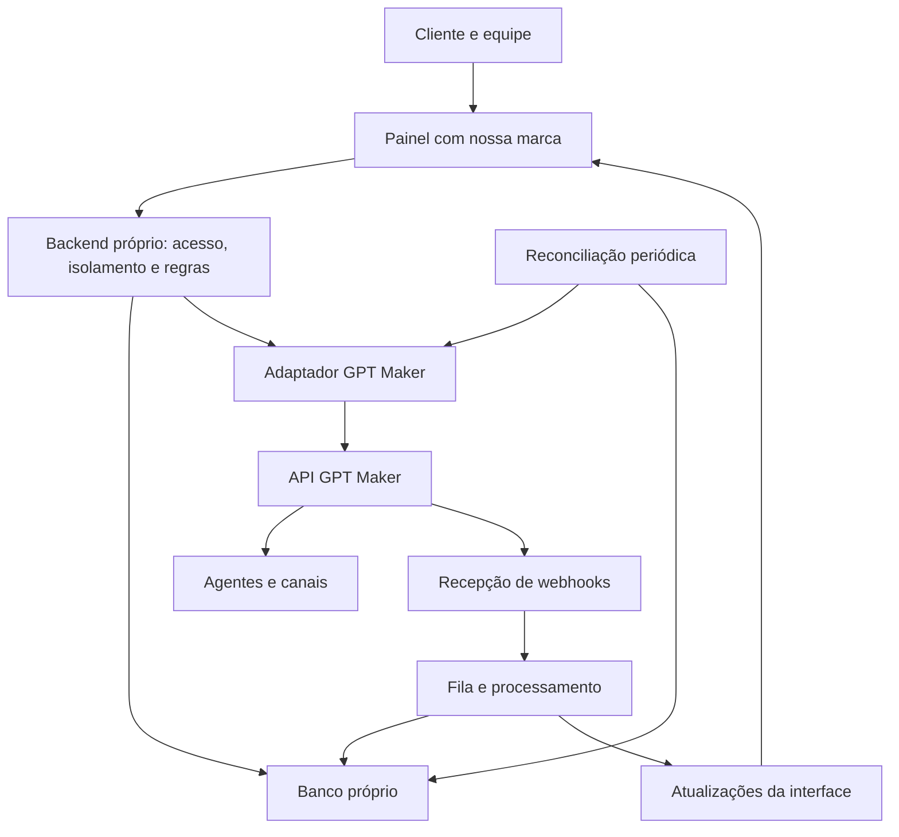

# Painel próprio com tecnologia GPT Maker

Análise documental em 09/10/2026. Foram examinados o material anexado, o índice público, as 72 operações do OpenAPI e páginas de uso e integração. Não foram feitas chamadas autenticadas nem testes em uma conta real. “Documentado” não equivale a “homologado”.

## Parecer

É tecnicamente viável construir uma plataforma com marca, interface, usuários, permissões e indicadores próprios, usando GPT Maker para execução dos agentes e conversas. A cobertura é especialmente boa para operar agentes e atendimentos já provisionados. O ponto menos comprovado é automatizar integralmente o cadastro de clientes, a contratação e a autorização inicial dos canais.

A arquitetura anexada — interface própria → backend próprio → API GPT Maker, com eventos retornando por webhooks — é adequada. Recomendo avançar com uma prova de integração antes de desenhar todo o produto como se cada função do painel original tivesse equivalente público.

Fontes: [introdução à API](https://developer.gptmaker.ai/api-reference/introduction), [índice](https://developer.gptmaker.ai/llms.txt), [OpenAPI oficial](https://developer.gptmaker.ai/api-reference/openapi.json).

## Correções e complementos ao material anexado

1. **Criação de conhecimento não se limita a texto.** O POST de treinamentos contém quatro alternativas no `oneOf`: TEXT, WEBSITE, VIDEO e DOCUMENT. A leitura da página com a aba Texto selecionada omite as demais alternativas. A edição, esta sim, está documentada apenas para TEXT; as outras fontes precisam ser removidas e adicionadas novamente. Documento é enviado por URL, nome e MIME, não por upload binário direto. Nossa aplicação precisa hospedar o arquivo para o provedor acessá-lo, com validade suficiente para o processamento. Formatos, tamanho e tempo de processamento precisam de teste. [Criação](https://developer.gptmaker.ai/api-reference/agents/create-training), [edição](https://developer.gptmaker.ai/api-reference/trainings/update-training).
2. **Há 72 operações na especificação consultada**, incluindo exportação de atendimentos em `/v2/workspace/{workspaceId}/export`, ausente do índice de páginas consultado. A exportação tem inconsistência: descrição menciona CSV, resposta declara JSON. Não escolher o parser antes de verificar uma resposta real.
3. **Criar o registro de um canal não comprova conectá-lo integralmente.** O contrato cria nome, tipo e vínculo opcional ao agente. Não documenta todos os fluxos de credenciais e autorização de Instagram, Messenger, Cloud API ou Mercado Livre. A documentação de uso orienta conexão pelo painel original. [Criação](https://developer.gptmaker.ai/api-reference/channels/create-channel-workspace), [guia de canais](https://developer.gptmaker.ai/agents/agent-channels).
4. **Usuários próprios não se tornam membros GPT Maker automaticamente.** Assumir atendimento não recebe um usuário local como parâmetro; regras de transferência usam `userId` do fornecedor. Atribuição a operadores, filas, concorrência e auditoria devem existir localmente, e a relação com usuários do fornecedor precisa ser homologada. [Assumir](https://developer.gptmaker.ai/api-reference/chats/start-human), [regras](https://developer.gptmaker.ai/api-reference/transfer-rules/create-transfer-rules).
5. **Ausência de transferência não comprova resolução pela IA.** Abandono e encerramento automático também podem encerrar sessões. O indicador inicial deve ser “encerrados sem transferência registrada”, com definição explícita, e não “problemas resolvidos pela IA”.
6. **Personalização do widget não comprova remoção integral da marca.** O contrato expõe cores, textos, sugestões e origens; não explicita remoção de atribuição, domínio próprio ou revenda. Um widget próprio usando a API de conversa amplia nosso controle visual, mas requer construção da experiência completa. [Widget](https://developer.gptmaker.ai/api-reference/channels/widget/update-settings), [conversa](https://developer.gptmaker.ai/api-reference/agents/conversation).

## Cobertura para o produto

| Área | O que aproveitar | O que precisamos construir ou validar |
|---|---|---|
| Agentes | Criar, buscar, alterar, excluir, ativar, inativar, comportamento e configurações | Assistente de criação, modelos de instruções, revisão e permissões |
| Conhecimento | Listar, criar quatro tipos, editar texto, excluir e callback de processamento | Upload nosso, estados de processamento, correlação e teste de limites |
| Atendimento | Chats, histórico, envio de texto/mídia, intervenção humana e retorno à IA | Inbox, atribuição local, filas, bloqueio concorrente, confirmação de envio |
| Contatos | Consulta, atualização, exclusão e campos personalizados | Segmentação própria; não encontrei criação avulsa de contato no contrato |
| Canais | Listagem por workspace, criação, vínculo a agente, configurações, conexão reportada e QR | Homologação de conexão por tipo; não prometer todos no lançamento |
| Automações | Ações de inatividade e regras de transferência humano/agente | Editor visual limitado às operações suportadas, prevenção de ciclos |
| Ferramentas | Intenções HTTP/instruções e conexões MCP | Catálogo curado, gestão de segredos, autorizações e testes |
| Métricas | Sessões de atendimento, mensagens e consumo por agente/data/modelo | Banco analítico, fórmulas, resultados comerciais e análise de qualidade |
| Administração | Listagem de workspaces e consulta de saldo/status | Login, equipe, permissões, marca, assinatura e auditoria próprias |

O inventário detalhado está em MATRIZ-API.md. A cobertura de edição e exclusão de mensagens é específica: Z-API, Telegram e Widget. Excluir uma conversa ou limpar o histórico não deve ser confundido com apagar mensagens entregues no canal. [Edição de mensagens](https://developer.gptmaker.ai/api-reference/chats/edit-message).

## Experiência recomendada

Organizar a interface por tarefas do cliente, reduzindo a exposição de termos técnicos.

| Tela | Experiência proposta | Dados/ações |
|---|---|---|
| Visão geral | Atendimentos, fila, canais desconectados, consumo e pendências | Interactions, channels, credits e análises locais |
| Atendimento | Três colunas: conversas, histórico e contato; controle IA/humano visível | Chats, mensagens, contato e atribuição local |
| Agentes | Cards com função e canais; criação guiada; botão de teste | Agents, settings, conversation |
| Conhecimento | Fontes, data de envio, processamento e correções pendentes | Trainings, callback e registro local |
| Canais | Cards com conexão, agente e ação compatível com cada canal | Channels, config, QR e widget |
| Resultados | Volume, transferências, duração, consumo e oportunidades de melhoria | Agregações locais reconciliadas com API |
| Configurações | Empresa, pessoas, acessos e plano | Nosso banco |

Dentro de Agentes: visão geral, comportamento, conhecimento, teste, automações, ferramentas e histórico. No início, automações e integrações avançadas podem ficar restritas aos administradores da operação.

Toda tela deve distinguir vazio, carregando, falha, sem permissão, pendente de confirmação e dados desatualizados. Usar data da última sincronização. Nunca transformar erro do fornecedor em “zero atendimentos” ou “canal desconectado”.

Um fluxo inicial simples: cadastrar empresa → vincular workspace provisionado → criar agente com formulário guiado → adicionar conhecimento → testar resposta → conectar um canal homologado → acompanhar atendimento.

## Arquitetura proposta

O token Bearer fica exclusivamente no backend, protegido em armazenamento de segredos. Cada chamada resolve a organização autenticada para seus recursos permitidos. Nunca aceitar `agentId`, `chatId` ou `workspaceId` arbitrário do navegador sem conferir pertencimento.

Recomendo um workspace por empresa cliente, condicionado às regras comerciais e de provisionamento do fornecedor. Não encontrei criação de workspace via API pública. O primeiro onboarding pode ser assistido: provisionar no GPT Maker e vincular no nosso painel administrativo. Token da conta pode alcançar mais de um workspace; essa separação não substitui a autorização no backend.

O GPT Maker permanece autoridade para configuração efetiva do agente, conhecimento processado, mensagens do canal e consumo reportado. Nosso banco governa organizações, usuários, papéis, atribuições, marca, auditoria, cobrança própria, oportunidades comerciais e métricas derivadas. Salvar configuração enviada não significa que foi aplicada: manter estado pendente, confirmar resposta e reler quando necessário.

Entidades iniciais: organizations, users, memberships, provider_connections, workspace_mappings, resource_mappings, operator_assignments, audit_logs, webhook_events, sync_jobs, interaction_snapshots e usage_daily. Acrescentar arquivos/fontes de conhecimento quando houver upload; mensagens integrais só conforme requisitos de busca, retenção e análises.

Um adaptador concentra os contratos do fornecedor e expõe funções do nosso produto. Isso reduz acoplamento, mas trocar de motor ainda exigirá migrar conhecimento, canais, contexto e comportamentos. Não é uma troca automática de URL.

## Eventos e atualização do painel

Existem URLs configuráveis para nova mensagem, falta de conhecimento, transferência, primeira interação, início/fim de atendimento e criação/cancelamento de evento. São bons pontos de entrada para inbox e métricas, porém não demonstram entrega garantida, ordenação ou cobertura de todas as mensagens de saída. [Webhooks](https://developer.gptmaker.ai/api-reference/agents/webhooks).

O contrato consultado não define de forma suficiente payloads de todos os eventos, assinatura, identificador único, política de reenvio e SLA. A implementação deve capturar amostras reais, persistir antes de confirmar recebimento, processar em fila, deduplicar e reconciliar com consultas periódicas. Chaves de deduplicação dependem dos campos reais disponíveis.

Enquanto não houver autenticação de origem comprovada, evento não deve autorizar ações sensíveis por si só; pode disparar uma releitura autenticada do recurso. Verificar o mecanismo suportado pelo fornecedor. Não atribuir a um `tenant` vindo do payload autoridade para escolher qualquer organização local.

No inbox, enviar mensagem exige cuidado com timeout: o provedor pode ter aceitado o envio antes da conexão cair. Não repetir automaticamente um POST ambíguo, pois isso pode duplicar mensagens. Manter tentativa local e reconciliar resultado. Assumir conversa deve ter controle de concorrência entre nossos operadores; mudanças feitas no painel GPT Maker também precisam ser detectadas.

## Métricas que podemos entregar

| Indicador | Definição inicial |
|---|---|
| Atendimentos iniciados | IDs únicos de interação com startAt no período |
| Fila atual | Interações atualmente WAITING; mostrar atualização |
| Transferência registrada | Interações da coorte com transferAt / total da coorte |
| Duração até encerramento | resolvedAt − startAt, somente registros encerrados válidos |
| Encerrados sem transferência | RESOLVED sem transferAt / encerrados; é proxy operacional |
| Consumo | Créditos reportados por agente, dia e modelo |
| Custo médio estimado | Custo alocado do período / volume; explicitar rateio |
| Lacunas | Eventos de falta de conhecimento agrupados por tema, após validar payload |

Tempo de primeira resposta requer mensagens e identificação de papéis. Satisfação precisa de coleta própria. Conversão e receita precisam de CRM/resultado comercial. A classificação de sentimentos e motivos exige processamento adicional e revisão de qualidade.

O consumo disponível é agregado por agente/data/modelo, não custo exato por chat. Não chamar rateio de custo individual observado. A listagem de atendimentos não documenta filtro temporal nem cursor de atualização; dashboards históricos exigem paginação, snapshots e reconciliação de estados mutáveis. Não presumir ordenação sem teste. [Atendimentos](https://developer.gptmaker.ai/api-reference/interactions/list-interactions), [consumo](https://developer.gptmaker.ai/api-reference/agents/credits-spent).

## Limites comerciais e funcionais

Não identifiquei operações públicas para criar workspaces, convidar membros, contratar plano/comprar créditos ou CRUD completo de negócios e funis. Integrações nativas citadas na documentação de uso não equivalem a endpoints de configuração pública. [Integrações nativas](https://developer.gptmaker.ai/agents/agent-integrations).

O endpoint de início de conversa declara suporte somente a WhatsApp não oficial. Não usá-lo como fundamento de disparos oficiais ou templates Meta. [Iniciar conversa](https://developer.gptmaker.ai/api-reference/channels/start-conversation).

Marca própria no frontend é uma decisão de desenvolvimento. Direito de revender, remover atribuição e licenciar operadores é questão a confirmar com GPT Maker. A documentação técnica analisada não comprova esses direitos. Não presumi que nossos usuários estejam isentos dos limites comerciais do fornecedor.

A cobrança é por créditos com consumo dependente do modelo. Nosso plano pode ser próprio, mas precisa definir o que vende: atendimento, resposta ou franquia. Não converter créditos em interações com fator fixo para todos os modelos. Custo total inclui assinatura, excedentes, canais, infraestrutura, armazenamento e análises adicionais. [Cobrança](https://developer.gptmaker.ai/billing).

## Qualidade do contrato técnico

Não gerar um cliente automaticamente e tratá-lo como correto sem revisão. Foram encontrados:

- `GET /v2/agent/{id}/transfer-rules`: parâmetro declarado como agentId.
- `POST /v2/agent/{agentId}/mcp/add`: parâmetro declarado como mcpId.
- Consulta e atualização de contato com parâmetros de rota não declarados.
- Algumas listagens declaradas como objeto, outras como array e canais como data/count.
- Operações MCP de ativar, inativar e sincronizar usam GET apesar de alterarem estado; impedir cache, prefetch e execução automática.
- `signMessages` aparece na escrita de settings, mas não na leitura; limite descrito como nullable sem definição equivalente na escrita.
- Várias alternativas oneOf não têm required suficiente para discriminar os formatos. O adaptador deve validar a variante explicitamente.
- `maxDailyMessages` é descrito como limite por atendimento, apesar do nome sugerir diário. Não rotular como quota diária sem homologar.
- Configuração de canal aceita campos adicionais; isso não comprova que qualquer chave inventada tenha efeito.

Manter o OpenAPI original, registrar ajustes locais separados e validar respostas em execução. Nenhuma dessas divergências comprova falha do serviço; indicam insuficiência documental.

## Ordem de execução e aceite

1. **Prova de integração:** autenticar no backend, vincular workspace, listar agentes e garantir isolamento entre duas organizações. Testar edição reversível em agente de homologação.
2. **Jornada completa:** criar agente, enviar conhecimento, confirmar processamento, testar resposta, receber conversa em um canal, assumir e devolver à IA. Aceite: o operador conclui o fluxo pela nossa interface.
3. **Painel operacional:** inbox, contatos, canais, sincronização e indicadores básicos. Aceite: mensagens não duplicam, mudanças de controle aparecem e falha do fornecedor é visível.
4. **Diferenciação:** lacunas de conhecimento, relatórios, automações e ferramentas curadas. Aceite: cada sugestão tem evidência e cada ferramenta tem autorização definida.
5. **Expansão comercial:** billing, CRM e onboarding automatizado apenas com os contratos e fluxos correspondentes confirmados.

O escopo inicial deve se concentrar em uma jornada real homologada. A quantidade de telas não é o critério de prontidão. O marco de sucesso é operar agentes e atendimento com nossa marca, sem expor credenciais e sem misturar dados entre clientes.

## Perguntas objetivas ao fornecedor

1. Quais condições permitem operação com marca própria, revenda e widget sem atribuição? Como operadores externos são licenciados?
2. Existe provisionamento de workspace por API de parceiro e token restrito por workspace?
3. Quais canais têm conexão completa por API, incluindo OAuth, credenciais, reconexão e expiração?
4. Quais são payloads, autenticação, repetição, ordenação e cobertura dos webhooks?
5. Quais rate limits, limites de paginação, retenção e garantias de disponibilidade se aplicam?
6. Como identificar o operador humano em chamadas feitas por uma credencial de integração?
7. Quais limites e estados existem para ingestão de documentos, sites e vídeos?
8. Existe API de templates/disparos oficiais, equipes, departamentos, CRM e cobrança fora da documentação pública?

Estas perguntas não impedem o início da prova técnica; delimitam o que não deve ser prometido como pronto para comercialização.
