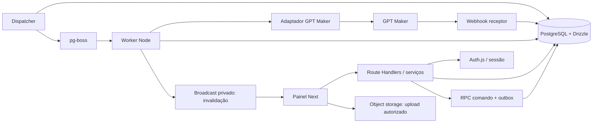

# Arquitetura, dados e processamento

## Visão de execução



Web e worker compartilham código de domínio e contratos, mas têm entrypoints e credenciais separados. Route Handlers fazem autenticação, autorização, validação e chamam serviços; não concentram regras de negócio. Jobs não são executados em `setTimeout` de uma requisição nem depois de responder HTTP sem persistência.

Dados interativos são snapshots locais com `synced_at`, `sync_status` e erro sanitizado. Polling do navegador consulta o BFF, não dispara uma chamada GPT Maker por operador. Solicitar refresh cria/coalesce um job por organização/recurso; leituras diretas ocasionais passam pelo adaptador e orçamento de chamadas.

## Autenticação e autorização

Auth.js cuida da sessão; membership local define papel por organização. Validar sessão no servidor usando a API server-side da versão fixada, nunca confiar apenas no conteúdo de cookie enviado pelo cliente. Convites e mudanças de papel são operações autenticadas, auditadas e restritas.

Toda entrada de serviço recebe um contexto derivado no servidor:

```ts
type OrganizationContext = Readonly<{
  organizationId: string;
  actorId: string;
  role: OrganizationRole;
  requestId: string;
}>;
```

`orgSlug` resolve para ID e membership. O cliente não escolhe o papel. Cache, query keys, caminhos de storage e jobs incluem organização. IDs de recursos são opacos e resolvidos por associação local; não bastam por si para autorizar.

**BFF comum:** Auth.js + Drizzle/repositories com guards por organização e papel em toda operação. **Exceções privilegiadas:** worker, recepção de webhook e armazenamento de credenciais usam módulos server-only restritos. Esses caminhos devem validar organização e associação em toda operação, ter testes específicos e não expor cliente privilegiado genérico a features.

O isolamento principal é aplicado no servidor e reforçado por constraints no banco: todas as queries de negócio recebem `organization_id`, FKs compostas impedem relação cruzada e mutações sensíveis passam por transação única no backend. Não haverá Data API pública do banco. Se o projeto decidir usar Row Level Security nativo do PostgreSQL depois, ela será camada adicional, não substituto dos guards do BFF.

## Modelo lógico

UUIDs internos; IDs do fornecedor como texto. Timestamps em `timestamptz` UTC; exibição pelo timezone da organização. Datas de aniversário como `date`. Valores monetários locais em unidade mínima + moeda, nunca float. Limites são validados em aplicação e constraints.

Todas as entidades de empresa levam `organization_id NOT NULL`. Exceções intencionais: profiles, platform_admins, catálogo global de versões/capabilities e estruturas internas de fila. Foreign keys de entidades empresariais usam `(organization_id, parent_id)` → `(organization_id, id)`, com UNIQUE correspondente, impedindo referência cruzada.

| Entidade | Campos principais e invariantes |
|---|---|
| organizations | id, slug único, name, timezone, status, created_at, deleted_at; exclusão começa por bloqueio de operações |
| users/profiles | id ligado à conta Auth.js, email, display_name, locale; não armazena papel global de cliente |
| organization_members | organization_id, user_id, role, status, joined_at; unique(org,user); owner final não pode ser removido |
| invitations | organization_id, email normalizado, role, token_hash, expires_at, accepted_at; uso único e expiração |
| platform_admins | user_id, status; acesso /ops separado, sem associação automática a todos os tenants |
| provider_connections | id, organization_id, provider, state, credential_ref, last_verified_at; nunca token em JSON de resposta |
| provider_credentials | id, organization_id, encrypted_secret, nonce, key_version; schema privado sem grant para authenticated |
| workspace_mappings | id, organization_id, connection_id, provider_workspace_id; vínculo único por provedor/workspace no MVP |
| agent_mappings | id, organization_id, workspace_mapping_id, provider_agent_id, name, provider_snapshot, synced_at, observed_state, revision |
| knowledge_sources | id, organization_id, agent_id, type, title, storage_key/url, provider_training_id nullable, state, last_error, submitted_at, processed_at; correlação pendente até confirmação |
| channel_mappings | id, organization_id, workspace_mapping_id, agent_id nullable, provider_channel_id, type, connected nullable, synced_at; null significa desconhecido |
| contact_snapshots | id, organization_id, workspace_mapping_id, provider_contact_id, campos mínimos necessários, synced_at |
| chat_snapshots | id, organization_id, workspace_mapping_id, agent_id nullable, contact_id nullable, provider_chat_id, human_talk nullable, updated_at, synced_at |
| message_cache | id, organization_id, chat_id, provider_message_id, role, text/media_ref, provider_timestamp, cached_at, expires_at; unique(org,chat,provider_message_id) quando disponível |
| operator_assignments | id, organization_id, chat_id, operator_id, state, revision, lease_expires_at; no máximo uma atribuição ativa por chat |
| outbound_messages | id, organization_id, chat_id, operation_id, client_message_id, state, provider_message_id nullable, payload_ref, timestamps; sucesso HTTP não significa entrega ao destinatário |
| interaction_snapshots | id, organization_id, chat_id, provider_interaction_id, status, start_at, transfer_at, resolved_at, provider_user_id, synced_at |
| usage_daily | organization_id, provider_agent_id, provider_date, model, credits, fetched_at; unique(org,agent,date,model); substituir snapshot, não somar novamente |
| operations | id, organization_id, actor_id, kind, resource_id, idempotency_key, payload_hash, encrypted_payload/ref, status, attempt_count, result_ref, last_error, timestamps |
| outbox | id, organization_id, operation_id, topic, available_at, dispatched_at; unique(operation_id,topic) |
| webhook_events | id, organization_id resolvida pelo endpoint, connection_id, event_type, dedup_key nullable, received_at, payload_ref, trust_level, processing_state |
| sync_checkpoints | organization_id, resource_type, scope_id, position, started_at, completed_at, coverage_state, last_error; não supor cursor que API não tem |
| audit_logs | id, organization_id, actor_type, actor_id, action, resource_type/id, redacted_diff, request_id, at; append-only para atores de aplicação |
| branding_settings | organization_id, display_name, logo_storage_key, token_overrides validados; tema global inicial, customização por cliente posterior |
| capability_overrides | organization_id, capability_key, enabled, evidence_ref, reviewed_at; somente plataforma administra |

`provider_snapshot` não é despejo irrestrito: whitelist, versão do schema, remoção de segredo e limites de tamanho. Não usar campos `tenant` retornados pelo fornecedor como ID interno da empresa.

Índices mínimos: todas as FKs; chats `(organization_id, updated_at DESC,id)`; interações `(organization_id,start_at,id)`; fila local `(status,available_at)`; auditoria `(organization_id,at,id)`; mensagens `(organization_id,chat_id,provider_timestamp,id)`; unique IDs externos incluindo escopo necessário. Definir TTL e índices com EXPLAIN em dados de teste representativos.

CRM, planos, assinatura e ledger financeiro são módulos P2 separados. Não criar meia dúzia de tabelas de cobrança sem fechar unidade vendida e regra de medição.

## Migrações

Migrations em `db/migrations/<timestamp>_<description>.sql` ou geradas pelo Drizzle em pasta equivalente, sempre revisáveis em SQL. A06 é único owner de migrations/types. Banco de fila usa schema próprio administrado por pg-boss na versão fixada. Jobs com referência a operações não carregam credenciais nem mensagens completas.

Nunca rodar migration destrutiva automaticamente no início de cada container. CI testa banco vazio e atualização de versão anterior; promoção tem etapa própria de migration. Expandir esquema antes de publicar código novo; remover colunas apenas depois que versões antigas e jobs antigos não as usam.

## Comandos, outbox e entrega

1. BFF autentica, valida papel e resolve IDs locais.
2. RPC atômica grava operação + outbox + auditoria de solicitação; em uma transação SQL.
3. Dispatcher lê outbox e publica job com referência à operação. Marcar despachado depois da confirmação da fila.
4. Se cair entre publicação e marcação, haverá repetição possível. Worker reclama operação de forma atômica e reconhece estados já concluídos. Não prometer exactly-once de efeitos remotos.
5. Worker revalida organização ativa, vínculo e autorização atual para ações delegadas antes do envio. Jobs de sistema têm ator SYSTEM explícito.
6. Adaptador chama o GPT Maker com timeout e classificação da operação.
7. Atualizar operação/snapshot/auditoria; emitir invalidação após commit. Perda de Broadcast não perde o resultado: polling/reconciliação recuperam.

Estados de operação: `PENDING → RUNNING → SUCCEEDED | FAILED | OUTCOME_UNKNOWN`; `CANCELED` só antes de efeito remoto. `OUTCOME_UNKNOWN` fica pendente de reconciliação ou decisão explícita; não é falha segura para repetir. Idempotency-Key local com payload_hash retorna a mesma operação; chave repetida com payload diferente retorna conflito.

GET de leitura aceita retry com backoff/jitter limitado; respeitar Retry-After quando presente. Não classificar todos os GET como leitura: MCP possui GET que altera estado. POST de envio/criação com timeout após possível transmissão entra em outcome_unknown. Se o fornecedor não oferece ID de correlação consultável, não inventar certeza por igualdade aproximada de texto.

Queue connection: conexão PostgreSQL direta ou pool compatível com a versão/recursos pg-boss; não usar transaction pooling como escolha automática. Limitar conexões/polling por processo. Confirmar transaction boundaries do backend e não misturar efeito externo dentro da transação. [pg-boss](https://github.com/timgit/pg-boss).

## Controle humano

Estados: `AI_ACTIVE`, `CLAIM_PENDING`, `HUMAN_ACTIVE`, `RELEASE_PENDING`, `UNKNOWN`. Atribuição local e controle observado no fornecedor são campos distintos.

Assumir: CAS de revision/lease local → comando → confirmação do fornecedor → estado humano. Concorrente perde com 409 e vê responsável atual. Envio manual exige controle humano confirmado e operador autorizado. Lease expira após perda de sessão conforme política, mas expiração não devolve automaticamente a IA: isso requer comando confirmado. Primeiro valor de lease 60 s e heartbeat 20 s são parâmetros locais de teste, não semântica do GPT Maker.

Devolver: bloquear novas mensagens manuais, enfileirar release, confirmar e limpar atribuição. Se ocorrer falha, manter estado pendente/desconhecido. Mudanças externas pelo painel original entram pela reconciliação e geram indicação ao operador. Serializar comandos por chat; não permitir dois efeitos concorrentes de handoff.

## Conhecimento e arquivos

Estados locais: `DRAFT`, `UPLOADING`, `SUBMITTING`, `PROCESSING`, `READY`, `FAILED`, `UNKNOWN`, `REPLACING`. Só mostrar READY com evidência homologada. A resposta de criação não fornece necessariamente ID: callback/relistagem e correspondência confiável precisam de teste. Submissões indistinguíveis no mesmo agente podem ser serializadas; falta de correlação não pode ser ocultada por marcação automática de sucesso.

Arquivo vai para object storage privado por caminho de organização, MIME/tamanho permitidos e URL assinada com validade compatível com ingestão medida. Não persistir URL assinada como identificação durável; guardar chave. Substituir documento não é edição nativa: criar e confirmar nova fonte antes de apagar a antiga quando o comportamento real permitir, evitando lacuna de conhecimento. Exclusão exige confirmação de escopo.

## Webhooks, sincronização e histórico

Endpoint tem identificador opaco ligado a conexão conhecida; nunca escolhe organização por campo arbitrário do payload. Confirmar recebimento somente após persistência durável. Assinatura oficial deve ser validada se suportada; segredo em URL pode reduzir exposição, mas não equivale a assinatura criptográfica. Sem origem autenticada, payload é hint: realizar releitura autenticada antes de alterar dados confiáveis ou disparar efeito.

Eventos sem autenticação que não permitem releitura ficam quarentenados/não confiáveis. Não contabilizar automaticamente lacunas de conhecimento ou resultados comerciais com esses eventos. Capturar exemplos reais e registrar campos, IDs, ordenação, repetição e tamanho. Dedup por ID oficial quando existir; fallback composto só após validar risco de colisão.

Sincronização inicial paginada registra cobertura parcial/completa. Reconciliação de chats ativos tem prioridade; backfill histórico roda com limite por empresa. Nenhum filtro/ordenação/cursor não documentado é assumido. Interações antigas podem mudar: revisitar janela móvel e amostras históricas; janela inicial 7 dias é política nossa ajustável, não garantia de captura total.

Polling proposto: inbox visível 5 s, dashboard 30 s, aba oculta suspensa; consultar snapshot local. Worker inicialmente limita uma chamada em voo por conexão e aplica orçamento configurável conservador, calibrado no spike, sem anunciar rate limit do fornecedor. TTL de staleness 60 s inbox/5 min dashboard é alvo local; UI mostra timestamp e cobertura.

Broadcast privado, quando habilitado, carrega apenas organização autorizada, tipo/referência local e revision. Assinatura do canal requer membership. Validar revogação de membership em conexão já aberta; até existir teste satisfatório, conteúdo continua sendo obtido no BFF e nenhum PII é transmitido pelo broadcast.
