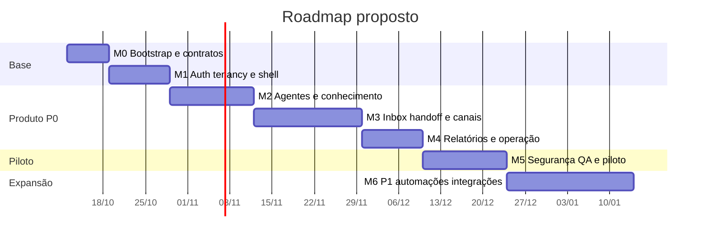

# Roadmap e backlog

Versão 1.0, 10/10/2026. Este roadmap é uma proposta de execução para chegar a um piloto realista do painel próprio sobre GPT Maker. As durações são estimativas por ordem de grandeza, assumindo 2 a 4 pessoas/agentes técnicos trabalhando com revisão. Contas, domínio, marca, repositório remoto, workspace GPT Maker e canal real precisam ser providos ou autorizados para homologação.

## Estratégia de entrega

O primeiro produto vendável não precisa replicar o painel inteiro. Ele precisa operar a jornada essencial com segurança: organização isolada, agente, conhecimento, teste, canal, atendimento, handoff e relatório mínimo. O roadmap prioriza verticais completas antes de recursos laterais.

Cada fase termina com evidência. Sem evidência, o item continua em andamento, mesmo que a interface esteja desenhada. Capabilities reais dependem de homologação autenticada.

As datas acima são ilustrativas a partir de 12/10/2026 para ordenar o trabalho. Não são compromisso de entrega sem equipe, credenciais, aprovação comercial e canal homologado.

## Gates

| Gate | Condição para avançar |
|---|---|
| G0 — Pronto para implementar | stack aprovada, repo autorizado, responsáveis definidos, PostgreSQL/Railway ou substitutos definidos |
| G1 — Base segura | login, organização, tenant guards, seeds de duas organizações, CI e shell passam QA-001/002/003 |
| G2 — Integração controlada | adaptador lista/cria agente em staging ou mock contratual; mutações assíncronas com outbox |
| G3 — Jornada operacional | criar agente, adicionar conhecimento, testar, listar inbox e handoff sem vazamento |
| G4 — Canal piloto | pelo menos um canal real conectado/assistido, mensagem de teste controlada, envio sem retry cego |
| G5 — Piloto liberado | P0 QA aprovado, backup restore exercitado, observabilidade e suporte definidos |

## Fases

### M0 — Bootstrap e contratos

Objetivo: transformar a especificação em repositório executável com decisões congeladas e contratos iniciais.

Owners: A00, A10, A04, A06, A08.

Entregas:

- monorepo pnpm com `apps/web`, `apps/worker`, `packages/*`;
- Next, TypeScript strict, lint, format, test runner;
- PostgreSQL local/staging definido;
- contratos `ApiSuccess`, `ApiError`, `OperationRef`;
- OpenAPI GPT Maker versionado e adaptador stub;
- CODEOWNERS, ADRs e README de execução.

Aceite: build vazio passa, CI roda, duas organizações seedadas localmente, docs de env sem segredos reais.

### M1 — Auth, tenancy e shell

Objetivo: provar isolamento, organização e navegação base.

Owners: A03, A04, A06, A08, A09.

Entregas:

- login/logout/recuperação;
- memberships, convites e papéis;
- rotas `/app/[orgSlug]`;
- sidebar, dashboard vazio, settings equipe;
- constraints, tenant guards e storage path privado;
- QA-001/002/003/005.

Aceite: usuário de A não lê B por URL, API, object storage ou query; revogação bloqueia próxima ação; troca de organização limpa cache.

### M2 — Agentes, laboratório e conhecimento

Objetivo: criar e testar agente com fonte de conhecimento processável.

Owners: A05, A04, A07, A03, A02, A08.

Entregas:

- listar/criar/editar/ativar agente;
- laboratório de teste;
- conhecimento TEXT;
- DOCUMENT condicional com upload privado;
- operação/outbox/worker para mutações;
- estados `PROCESSING`, `READY`, `FAILED`, `UNKNOWN`;
- capabilities de conhecimento.

Aceite: criação não duplica por timeout/duplo clique; fonte só fica pronta com evidência; trainer não acessa conversa de produção.

### M3 — Canais, inbox e handoff

Objetivo: operar atendimento real controlado.

Owners: A05, A07, A04, A03, A08, A09.

Entregas:

- listagem e estado de canais;
- conexão assistida do canal piloto;
- sync de chats/mensagens;
- inbox com filtros, conversa e contato;
- atribuição local exclusiva;
- assumir/devolver;
- envio textual com `OUTCOME_UNKNOWN`;
- webhook como hint.

Aceite: dois operadores não assumem o mesmo chat; mensagem ambígua não é reenviada; webhook forjado não altera estado confiável; canal criado não aparece como conectado sem teste.

### M4 — Relatórios, operação e auditoria

Objetivo: dar gestão e suporte ao piloto sem depender de inspeção manual do banco.

Owners: A04, A06, A07, A03, A08, A10.

Entregas:

- dashboard operacional;
- relatórios de volume, transferência e uso;
- audit logs;
- console `/ops` para implantação, jobs e eventos;
- sync checkpoints e staleness;
- runbooks iniciais.

Aceite: dados indisponíveis não viram zero; relatório informa cobertura/fuso; auditoria cobre alterações sensíveis; `/ops` não mostra transcrições por padrão.

### M5 — Hardening e piloto

Objetivo: aprovar P0 para uso com cliente controlado.

Owners: todos, com A08/A09/A10 liderando gate.

Entregas:

- suíte P0 completa;
- acessibilidade da jornada essencial;
- backup/restore exercitado;
- observabilidade e alertas;
- rotação de credenciais testada;
- plano de suporte e incidente;
- checklist de go/no-go.

Aceite: zero vazamento cross-org conhecido, nenhum segredo no client/log, restore comprovado, canal real testado, responsável humano do piloto nomeado.

### M6 — Expansão P1

Objetivo: ampliar valor depois da operação básica estabilizada.

Itens candidatos: WEBSITE/VIDEO, mídia, editar/excluir mensagem por canal, lacunas de conhecimento, transfer rules, ferramentas HTTP/MCP, widget, exportações, relatórios avançados, notas/etiquetas e comparação de histórico.

Aceite: cada capability tem gate próprio e não entra escondida em P0.

## Backlog inicial

| ID | Fase | Owner | Requisitos | Entrega | Aceite |
|---|---|---|---|---|---|
| BK-001 | M0 | A10 | NFR-010 | Criar monorepo pnpm e CI base | `pnpm lint`, typecheck e test executam no CI |
| BK-002 | M0 | A00 | ADR | Registrar ADRs 001–008 no repo | decisão, alternativa e gatilho de revisão claros |
| BK-003 | M0 | A04 | FR-039 | Criar pacote `contracts` com envelope API | schemas exportados e testados |
| BK-004 | M0 | A05 | matriz API | Versionar OpenAPI e divergências | snapshot, hash e notas no repo |
| BK-005 | M0 | A08 | QA | Criar fixtures sintéticas base | duas orgs, papéis e recursos cruzados |
| BK-006 | M1 | A06 | FR-001/003 | Migrações de organizations/members/invitations | constraints e tenant guards testados |
| BK-007 | M1 | A03 | UI-01/02 | Login, convite e seletor de organização | sessão inválida não acessa app |
| BK-008 | M1 | A04 | FR-002 | Guard `OrganizationContext` | URL de B retorna 404/403 sem metadado |
| BK-009 | M1 | A06 | NFR-001 | Object storage privado por organização | upload/list cross-org negado |
| BK-010 | M1 | A08 | QA-001/002/003 | Testes isolamento e revogação | falhas bloqueiam PR |
| BK-011 | M2 | A05 | FR-006 | Adapter `listAgents` | fixture real ou mock contratual com erro tipado |
| BK-012 | M2 | A04 | FR-006/007 | Endpoints agentes | permissões e operação assíncrona |
| BK-013 | M2 | A03 | UI-07/08/09 | Telas de agentes | empty/loading/error/pending |
| BK-014 | M2 | A07 | FR-007 | Outbox dispatcher + worker básico | queda não perde operação |
| BK-015 | M2 | A05 | FR-010 | TEXT training create/update/delete | READY só por evidência |
| BK-016 | M2 | A06 | FR-011 | Bucket e signed URL para documento | URL não vaza em log |
| BK-017 | M2 | A03 | UI-11/12 | Conhecimento TEXT/DOCUMENT | upload e estados visíveis |
| BK-018 | M2 | A08 | QA-012/013 | Testes treinamento adversos | timeout não vira sucesso |
| BK-019 | M2 | A03 | UI-10 | Laboratório de teste | contexto isolado por agente |
| BK-020 | M3 | A05 | FR-023/024 | Adapter canais e QR quando suportado | criado ≠ conectado |
| BK-021 | M3 | A03 | UI-15 | Lista/detalhe de canais | estado stale visível |
| BK-022 | M3 | A07 | FR-015/035 | Sync chats/mensagens | dedup e cobertura parcial |
| BK-023 | M3 | A03 | UI-04/05 | Inbox e conversa | rolagem, novas mensagens, mobile |
| BK-024 | M3 | A04 | FR-016 | Atribuição exclusiva | concorrência retorna um vencedor |
| BK-025 | M3 | A05 | FR-017 | Start/stop human | confirmação remota ou unknown |
| BK-026 | M3 | A04 | FR-018 | Envio textual operation-safe | timeout vira `OUTCOME_UNKNOWN` |
| BK-027 | M3 | A07 | FR-035 | Webhook receptor | hint persistido e releitura |
| BK-028 | M3 | A08 | QA-006/007/009 | Testes handoff/envio/webhook | sem duplicar mensagem |
| BK-029 | M3 | A09 | NFR-002 | Redaction e varredura de segredo | bundle/HAR/log limpos |
| BK-030 | M4 | A07 | FR-026/027 | Sync interações/uso | cobertura e fuso corretos |
| BK-031 | M4 | A03 | UI-03/17 | Dashboard e relatórios | ausente ≠ zero |
| BK-032 | M4 | A04 | FR-033 | Audit logs | alterações críticas correlacionadas |
| BK-033 | M4 | A03/A04 | UI-22/FR-034 | Console `/ops` | metadados sem transcrição padrão |
| BK-034 | M4 | A10 | NFR-010 | Métricas e alertas | fila, credencial e sync monitorados |
| BK-035 | M5 | A08 | QA-001–022 P0 | Suíte gate P0 | relatório de release |
| BK-036 | M5 | A09 | NFR-012 | Retenção/exclusão/runbook | procedimento aprovado |
| BK-037 | M5 | A10 | NFR-011 | Backup/restore | ensaio em staging |
| BK-038 | M5 | A02/A08 | NFR-007 | Acessibilidade jornada P0 | teclado/contraste/zoom aprovados |
| BK-039 | M5 | A00 | gates | Go/no-go piloto | pendências e riscos aceitos |
| BK-040 | M6 | A05 | FR-012 | WEBSITE/VIDEO | capability por tipo |
| BK-041 | M6 | A05/A03 | FR-019/020 | Mídia e editar/excluir | canal suportado apenas |
| BK-042 | M6 | A04/A03 | FR-029 | Lacunas de conhecimento | revisão não publica automático |
| BK-043 | M6 | A05/A04 | FR-030 | Regras de transferência | destino validado |
| BK-044 | M6 | A05/A09 | FR-031 | HTTP/MCP tools | SSRF e segredos aprovados |
| BK-045 | M6 | A03/A05 | FR-025/038 | Widget e customização | contrato comercial claro |

## Dependências críticas

| Dependência | Impacto | Pode avançar sem ela? |
|---|---|---|
| Marca, logo e nome final | tokens, UI e domínio | sim, usando tokens provisórios |
| Conta GitHub/remote | CI remoto e colaboração | parcialmente, com repo local |
| PostgreSQL/Railway | staging e deploy | parcialmente, com local e docs |
| Credencial GPT Maker staging | homologação real | mock e adaptador avançam; capability não libera |
| Workspace GPT Maker por cliente | onboarding real | sim para arquitetura; não para piloto |
| Canal piloto | atendimento real | inbox mock/sync avança; G4 bloqueia |
| Contrato white-label | promessa comercial | produto técnico avança; comunicação pública bloqueia |
| Política de retenção | piloto com dados reais | desenvolvimento avança; produção bloqueia |

## Ordem das primeiras issues

1. BK-001, BK-002, BK-003, BK-005.
2. BK-006 e BK-008 antes de qualquer endpoint de domínio.
3. BK-007 depois de Auth.js e isolamento mínimo.
4. BK-011 e BK-014 em paralelo, mas integrar por operação persistida.
5. BK-013 somente após contratos de agente estáveis.
6. BK-015/017 fecham a primeira vertical útil.
7. BK-022/023/024/026 fecham a segunda vertical útil.

Esse sequenciamento evita construir tela antes de contrato essencial e evita chamar fornecedor sem operação durável.
